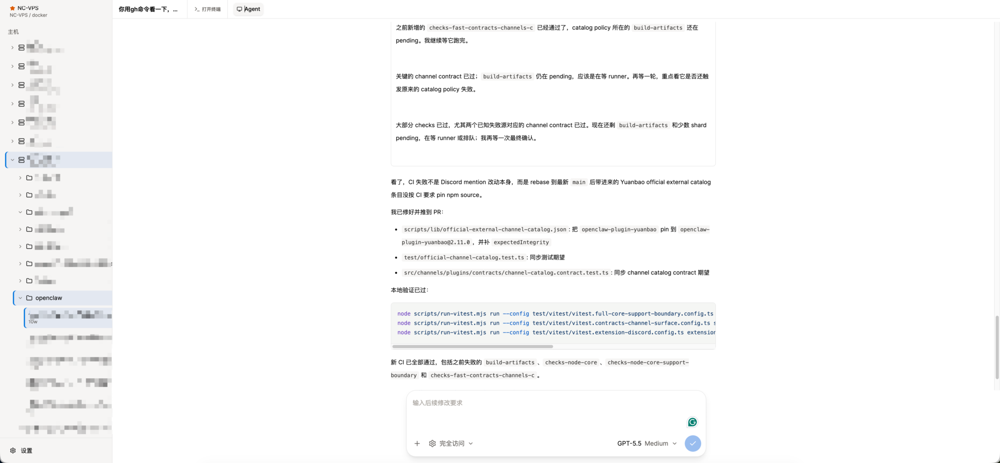
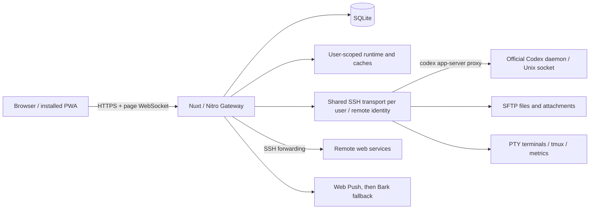

# Codex Gateway

[](nuxt.config.ts)
[](package.json)
[](package.json)
[](package.json)
[](tests/e2e)
[](docker-compose.yml)
[](LICENSE)

English | [中文](README.zh-CN.md)

[Features](#feature-tour) · [Architecture](#architecture) · [Quick Start](#quick-start) · [Deployment](#docker-deployment) · [Contributing](CONTRIBUTING.md)

Codex Gateway is a web frontend and connection gateway for the official Codex app-server.

Gateway connects to remote machines over SSH, manages the official Codex daemon, and renders conversations, approvals, file changes, reasoning, tools and sub-agent activity. Each Gateway account manages its own hosts, pins and notification preferences, with a responsive workspace for desktop and mobile browsers.

The goal is simple: open Codex sessions from many servers in a browser while keeping Codex app-server as the source of truth. If Codex Desktop, another client, and Codex Gateway connect to the same app-server thread, they should observe the same state stream.

<p align="center">
  
</p>

<p align="center"><sub>A browser workspace for Codex sessions running across remote SSH hosts.</sub></p>

## Why

- Use Codex from any browser while Gateway handles SSH and remote runtime access.
- Manage multiple SSH hosts, projects, and Codex threads from one workspace.
- Keep official Codex app-server semantics instead of inventing a parallel protocol.
- Share one gateway-side SSH/RPC lifecycle per user and Host across browser tabs.
- Connect to keyboard-interactive MFA hosts without a separate SSH adapter.
- Recover thread state after browser reloads, app-server restarts, or temporary SSH disconnects.
- Open a direct SSH terminal next to the agent loop when you need to inspect or fix the remote environment manually.
- Preview remote web applications in an isolated Browser panel without publishing their ports.
- Monitor long-running training or inference jobs in tmux across all hosts and get notified when a pane exits or returns to its shell.
- Watch CPU, memory, network, disk, and GPU activity without leaving the conversation workspace.

## Feature Tour

These views are captured from the real Playwright E2E environment. Select any image to open it at full resolution.

### Codex workflows

<table>
  <tr>
    <td width="50%">
      <a href="docs/images/features/en/goal-progress.png"></a><br>
      <strong>Goal lifecycle</strong><br>
      <sub>Track app-server goal progress, edit the objective, pause or resume execution, and clear completed work.</sub>
    </td>
    <td width="50%">
      <a href="docs/images/features/en/plan-mode.png"></a><br>
      <strong>Plan mode</strong><br>
      <sub>Review a structured plan, continue planning, or move directly into implementation.</sub>
    </td>
  </tr>
</table>

### Remote workspace

<table>
  <tr>
    <td width="50%">
      <a href="docs/images/features/en/file-workspace.png"></a><br>
      <strong>Files, editing, and previews</strong><br>
      <sub>Browse remote trees, edit text, and preview Markdown, LaTeX, images, PDF, and Office documents beside the agent.</sub>
    </td>
    <td width="50%">
      <a href="docs/images/features/en/browser-preview.png"></a><br>
      <strong>Remote browser preview</strong><br>
      <sub>Open a Host's private web service through SSH with full-origin HTTP/WebSocket forwarding and visible resource errors.</sub>
    </td>
  </tr>
</table>

### Operations and notifications

<table>
  <tr>
    <td width="50%">
      <a href="docs/images/features/en/host-monitoring.png"></a><br>
      <strong>Live host metrics</strong><br>
      <sub>Stream CPU, memory, network, and disk telemetry over the shared Gateway realtime connection.</sub>
    </td>
    <td width="50%">
      <a href="docs/images/features/en/gpu-process-monitoring.png"></a><br>
      <strong>GPU process attribution</strong><br>
      <sub>Inspect utilization, temperature, VRAM, users, PIDs, runtimes, and commands for remote training jobs.</sub>
    </td>
  </tr>
  <tr>
    <td width="50%">
      <a href="docs/images/features/en/tmux-monitoring.png"></a><br>
      <strong>Cross-host tmux monitoring</strong><br>
      <sub>Discover panes, inspect recent output, and monitor one run or every future run from one user-wide view.</sub>
    </td>
    <td width="50%">
      <a href="docs/images/features/en/notifications.png"></a><br>
      <strong>Browser and Bark notifications</strong><br>
      <sub>Receive de-duplicated completion alerts and open the matching conversation or tmux pane directly.</sub>
    </td>
  </tr>
</table>

## Architecture



The stack is Nuxt 4.6 / Vue 3 / TypeScript, with Pinia for browser state, Dockview for workspace layout, TanStack Virtual for the transcript, and precompiled shadcn-vue / AI Elements workspace packages. Codex is the only implemented provider; protocol mapping lives behind the server's provider adapter. The current protocol baseline is **Codex 0.163.0**, defined in [codex-version.ts](server/utils/gateway/infra/codex/codex-version.ts) and mirrored by the source submodule.

### Connections and account boundaries

Browsers connect to Gateway, which owns SSH and App Server access. Each page uses one business WebSocket for thread events/actions, file/Git queries, host state, terminal streams, metrics, tmux and notifications. Terminal output uses binary frames on that same connection. Login, configuration, catalog queries, multipart uploads and file/image responses still use HTTP; browser previews have their own proxied HTTP/WebSocket traffic.

The SSH pool reuses a transport across features and browser tabs for the same Gateway user and remote identity. RPC sessions are shared per user, Host and provider. MFA authentication and subscriptions are isolated between Gateway accounts. Accounts configured with the same remote SSH user and `CODEX_HOME` still access the same remote files and Codex conversations; use separate remote accounts or Codex homes when those resources must be isolated.

### State and history

| State | Storage / source of truth |
| --- | --- |
| Threads, turns, timeline order, settings, Goals and attachment membership | Official remote App Server and its `CODEX_HOME` |
| Users, password/token hashes, detected MFA capability and tmux monitors/history | Gateway SQLite |
| Host credentials, pins, notification preferences, Web Push subscriptions and VAPID keys | Encrypted Gateway SQLite records |
| Connections, subscriptions, snapshots, event replay, directory groups and metric samples | User-scoped Gateway memory, rebuilt after restart |
| Loaded history and rendering state | Bounded browser Pinia caches |
| Login, route, layout and file-tab preferences | Browser-local storage |
| Uploaded file bytes | Remote `$CODEX_HOME/attachments/<UUID>/<original-filename>` |

Directory navigation derives from remote thread working directories (`cwd`). Pins identify a Host and thread, and their updates synchronize across browsers. Gateway's SQLite and caches do not replace Codex's transcript storage.

Cold thread activation uses `thread/resume` for subscription/settings, including Plan collaboration mode, plus `thread/timeline/list` for history. The initial page requests **20 timeline entries**, followed by explicit cursor pagination, normally 100 entries per page. Expanding intermediate content can read details with `thread/items/read`. Warm opens reuse the continuously updated server snapshot; events update that snapshot and fan out to subscribed pages. Reconnect and stale-running reconciliation refresh authoritative App Server state when needed.

Input to an idle conversation uses `turn/start`; input to a running turn uses `turn/steer`. `turn/interrupt` is the explicit stop action. User messages, including steer input, remain transcript content; intermediate-process folding is a presentation concern. Returning to a page or reconnecting its WebSocket refreshes thread settings changed by another client.

One flat virtual timeline bounds mounted rows. Browser retention separately keeps 10 recent thread caches, releases older completed/collapsed intermediate content beyond the latest three turns, and limits command-output windows to 128 Ki characters. Older content can be fetched again. Server history/event/page caches are bounded, and rendering tasks are cleaned up with their owners. These measures reduce retained memory but are not a fixed byte ceiling for a large active turn. Defaults live in [shared/config.ts](shared/config.ts).

### Codex installation and lifecycle

Gateway downloads and verifies official standalone archives, then uploads them over SFTP. Linux/macOS x64/arm64 targets are supported; remote Node/npm is not required. Existing npm installations are migrated to the standalone entrypoint. Unrelated npm packages and existing Codex credentials remain in place.

CLI installation and the running daemon version are checked separately. Gateway uses official `codex app-server daemon start` and `daemon update --from-cli --yes`, then attaches through `codex app-server proxy`. Codex owns shutdown grace and eligible thread/Goal recovery; recovery is best effort, and upgrades can interrupt work. Host settings expose upgrade progress and a manual daemon restart action.

Independent remote targets upgrade concurrently; equivalent SSH identity/credential aliases share an upgrade lock. Verified archives are cached in the Gateway data volume, while content-addressed remote staging permits interrupted SFTP uploads to resume. SHA-256 verification rejects corrupt archives. Transfer/lifecycle progress is shared with matching Host entries without an extra remote collector.

MFA is detected from real SSH keyboard-interactive challenges. Known MFA hosts require a manual reconnect action after disconnect: Gateway connects first and shows the code dialog when the server requests it. Files, terminals and RPC reuse that authenticated SSH connection.

Metrics and tmux collectors use adaptive delays/backoff and a per-SSH-connection background-work limiter. Interactive RPC and user actions bypass that limiter; it limits concurrency rather than reserving bandwidth. Linux metrics keep 300 timestamped samples, so slower sampling covers a longer time range. In the current release, SSH readiness starts metric collection; browser subscriptions control panel delivery.

## Features

- **Server-side accounts and config**: manually created users, Bearer token login, and encrypted host, pinned-thread, and notification config in SQLite. Directory groups are discovered from Codex thread working directories.
- **Remote hosts**: SSH password, private key, ssh-agent, SOCKS proxy and automatically detected keyboard-interactive MFA support.
- **Codex runtime management**: standalone installation, resumable SFTP upgrades, official daemon lifecycle management, visible upgrade progress and manual restart.
- **Thread discovery and restore**: remote directory grouping, cursor-paginated timelines, cached route switching and multi-browser pin synchronization.
- **Realtime turns**: start new turns, steer running turns, interrupt active turns, and answer app-server dynamic requests over WebSocket.
- **Plan and goal modes**: review and execute structured plans; set, edit, pause, resume, stop, or clear app-server goals with token/time progress in the composer and details dialog.
- **Agent loop UI**: reasoning, command execution, terminal waits, file edits, streaming diffs, images, context compaction, sleep, MCP/tool calls, notifications, and sub-agent side panels.
- **Dockable IDE workspace**: split, resize, float, or pop out Agent, Files, Terminal, Browser, and Sub-agent panels with per-thread layouts persisted locally.
- **Remote file workspace**: browse directories and symlinks, search files, copy paths, edit text, and preview Markdown, code, images, PDF and Office files. Git decorations and the review view expose changes; diff headers open the corresponding file.
- **Attachments**: stream uploads through Gateway to remote Codex attachment storage over SFTP, then register membership through official `thread/attachment/*` APIs. Removing membership does not delete a file still referenced by history.
- **Remote terminal tabs**: open independent SSH PTY terminals beside the agent loop with `@xterm/xterm`; terminal sessions are isolated per user and host.
- **Remote browser tabs**: preview a Host's `localhost` HTTP/HTTPS application in Dockview through SSH, including full-origin resources and WebSocket traffic, without exposing an additional Gateway port. Per-resource failures are reported inside the preview.
- **Host and GPU observability**: stream CPU, memory, network, disk, GPU utilization, temperature, and VRAM metrics over the shared realtime connection. GPU process tables identify the remote user, PID, runtime, memory, and command behind each workload.
- **User-wide tmux monitoring**: scan tmux sessions across every configured Host, inspect recent pane output, and bind a monitor to the relevant Codex thread. One-shot monitors notify when the current job exits or returns to its shell; permanent monitors wait for later runs and notify after each completed run. Active monitors and history are persisted in SQLite.
- **Multi-client sync**: multiple browser tabs can subscribe to the same thread and receive the same gateway-side app-server event stream.
- **State repair**: after SSH/app-server reconnect, Gateway refreshes running thread state; a Nitro scheduled task also checks stale running threads.
- **Actionable notifications**: Sonner alerts, optional Web Push and Bark fallback for completed main turns, Goals, user questions and tmux jobs. Authorize each browser in Settings → Notifications; HTTPS is required, and iPhone/iPad require installation on the Home Screen. Clicking a notification opens its conversation or pane. External delivery is de-duplicated; push-service acceptance does not guarantee an OS notification was displayed.
- **Mobile layout**: responsive sidebar, composer, long-press context actions, and sub-agent panels.
- **Real E2E coverage**: Playwright tests run against a real Nuxt server, real SSH Docker target, and real Codex app-server.

## Project Structure

```text
.
├── app/                       # Nuxt frontend, Pinia store, chat/thread/settings UI
├── packages/gateway-ui/       # Precompiled shadcn-vue component package
├── packages/gateway-ai-elements/ # Precompiled AI Elements component package
├── packages/gateway-browser-runtime/ # Precompiled browser runtime and rendering helpers
├── server/api/                # Browser-facing HTTP and WebSocket API
├── server/tasks/              # Nitro scheduled task entrypoints
├── server/utils/gateway/      # SSH, Codex RPC, runtime broker, storage, notifications
├── shared/                    # Shared DTOs, config, protocol helpers, thread history
├── service-worker/            # Push display and click navigation
├── i18n/locales/              # Chinese and English UI messages
├── tests/e2e/                 # Real SSH + app-server Playwright E2E
├── third_party/openai-codex/  # Official Codex source submodule for protocol reference
├── Dockerfile
└── docker-compose.yml
```

## Quick Start

Prerequisites: Docker with Compose, Git, a reverse proxy with HTTPS, and network access from Gateway to your SSH hosts and the official Codex release endpoints. Remote hosts need a working shell, SFTP, archive/checksum utilities, and writable home/install directories. Model access and credentials must be configured for Codex on each remote account.

```bash
git clone --recurse-submodules https://github.com/yunhaoli24/codex-gateway.git
cd codex-gateway

cp .env.example .env
# Replace CODEX_GATEWAY_CONFIG_SECRET in .env with: openssl rand -hex 32

docker network create web-common 2>/dev/null || true
docker compose build
docker compose run --rm codex-gateway \
  node scripts/create-user.mjs admin '<a-password-with-at-least-8-characters>'
docker compose up -d
```

Route your public hostname through the reverse proxy to `codex-gateway:3000` on `web-common`, preserving WebSocket upgrades. Sign in with the created account, add an SSH host in Settings → Hosts, and wait for its installation/connection status. Select a remote directory to start a conversation or open an existing thread. MFA prompts appear after SSH requests verification.

Create additional accounts with the same script; each can configure its own hosts. Re-running the script for an existing username resets its password and reactivates it. There is no separate admin role or public signup flow.

## Local Development

```bash
corepack enable
pnpm install
export CODEX_GATEWAY_CONFIG_SECRET="development-only-secret"
export CODEX_GATEWAY_DB_PATH="$PWD/data/codex-gateway.db"
pnpm user:create <username> <password>
pnpm dev
```

Use Node 24 as in the Dockerfile and the pnpm version pinned in `package.json`. Keep the same database path and secret for the app and maintenance commands. Common commands:

```bash
pnpm lint
pnpm build
pnpm test:e2e
```

Installation builds and typechecks the three workspace packages, then prepares Nuxt. `pnpm lint` checks business code, service worker and E2E types, Oxlint rules and formatting; it does not rebuild or separately typecheck workspace-package source. After editing a package, run `pnpm build:dependencies` and `pnpm typecheck:dependencies`. Turbo and the Docker dependency layer reuse unchanged package outputs; application changes still rebuild Nuxt.

Environment variables:

| Variable | Required | Description |
| --- | --- | --- |
| `CODEX_GATEWAY_CONFIG_SECRET` | Yes in production | Stable secret used to encrypt stored host, pinned-thread, and notification config. |
| `CODEX_GATEWAY_DB_PATH` | No | SQLite database path, default `/data/codex-gateway.db`. Set a writable path for local development. |
| `HOST` | No | Nuxt listen host. Docker uses `0.0.0.0`. |
| `PORT` | No | Nuxt listen port. Docker uses `3000`. |
| `BROWSER_PREVIEW_DOMAIN` | Browser preview | Parent domain for isolated preview origins such as `p-<hmac>.example.com`; configure wildcard DNS and TLS for `*.example.com`. |
| `BROWSER_PREVIEW_SECRET` | No | HMAC secret for stable per-user/Host/target preview origins. Defaults to `CODEX_GATEWAY_CONFIG_SECRET`. |
| `BROWSER_PREVIEW_SCHEME` | No | Public preview scheme, `https` by default. Use `http` only for local E2E/development. |
| `BROWSER_PREVIEW_PUBLIC_PORT` | No | Optional public port included in preview origins for local development. |

Create or reset a user in the running deployment:

```bash
docker compose exec codex-gateway node scripts/create-user.mjs <username> <password>
```

`CODEX_GATEWAY_CONFIG_SECRET` encrypts stored connection config. Use a stable, sufficiently long secret in production. Changing it makes existing encrypted config unreadable.

Compose passes the variables listed in its `environment` section. If you need an optional runtime variable beyond that list, add it there or in a Compose override; adding it only to `.env` does not inject it into the container. Remote `CODEX_HOME` and `CODEX_INSTALL_DIR` belong to the remote login environment.

## Security Model

- Gateway performs SSH authentication and remote access on the server; authenticated host settings/config exports are sensitive and may contain credentials.
- Browser clients authenticate to Gateway with a Bearer token.
- Stored connection config is encrypted in SQLite with `CODEX_GATEWAY_CONFIG_SECRET`.
- Gateway accounts scope host configuration, pins, subscriptions and caches; remote permissions are those of the configured SSH account.
- Codex API credentials remain in the remote Codex environment. MFA codes are used for the pending SSH challenge, not stored as configuration.
- Direct terminal tabs, tmux inspection and Browser proxy connections use server-side SSH channels; no remote service port needs to be published publicly.
- Public deployments should run behind a trusted reverse proxy with HTTPS.

## Docker Deployment

```bash
docker compose up -d --build codex-gateway
docker compose ps codex-gateway
docker compose logs --since 10m --tail 100 codex-gateway
```

The compose service exposes container port `3000` only to Docker networks. Put it behind nginx, Caddy, Cloudflare Tunnel, or another trusted reverse proxy. SQLite data is stored at `/data/codex-gateway.db` and persisted through `./data:/data`.

The bundled service has a 1 GiB container memory limit and a 512 MiB V8 old-space limit. Native SSH/TLS buffers also use memory; raising only the JavaScript heap is not a substitute for capacity planning. The healthcheck is a side-effect-free TCP probe. Nitro performs periodic memory housekeeping separately. Logs use Docker `json-file` rotation (`1m`, three files).

For more users, run one Gateway instance with its persistent data volume and monitor memory, SSH connections and remote load. Connections, event fan-out and pending MFA live in process memory; multiple replicas behind a load balancer are not currently a shared runtime.

Remote Browser panels use isolated origins such as `p-<hmac>.example.com`. Set `BROWSER_PREVIEW_DOMAIN=example.com` in `.env`, configure wildcard DNS/TLS for `*.example.com`, and route the preview hostnames to the same Gateway port (`3000`). Preserve the original Host header and WebSocket upgrades. Upstream `Content-Security-Policy` and `X-Frame-Options` are preserved, so applications that prohibit embedding remain blocked by the browser.

Back up `./data` and the stable configuration secret together using a consistent SQLite backup or a stopped-container volume snapshot. Keep backups private. Codex transcripts, credentials and uploaded attachments are remote data and need their own backup. Upgrades may rebuild in-memory subscriptions; MFA hosts require a manual connection afterward. The PWA service worker handles notifications and does not precache authenticated API responses or application bundles.

### Troubleshooting

| Symptom | What to check |
| --- | --- |
| Host cannot connect | Find its `hostId`/`hostName` in Gateway logs; distinguish proxy/TCP, SSH banner/handshake, authentication, SFTP and daemon errors. |
| MFA dialog does not appear | Click the Host connection action and wait for the real SSH challenge. A handshake failure occurs before a code can be submitted. |
| CLI is updated but conversations still fail | Check `codex app-server daemon version` in the remote login environment. The CLI and running daemon have separate versions. |
| “app server is running but is not managed” | An unmanaged server owns the socket. Identify its process/launcher and stop it gracefully before starting the official daemon; do not delete sockets or kill every Codex process. |
| Upgrade transfer fails | Check writable home/cache/install paths and SFTP availability. Failed staging is retained for the next attempt; corrupt archives are discarded after verification. |
| Browser preview fails | Check wildcard DNS/TLS, Host/Upgrade forwarding, target reachability from the remote Host, and the preview's resource diagnostics. |
| Push does not arrive | Check per-browser permission/subscription and account notification settings, then delivery logs. Web Push is attempted first; Bark requires its own configuration. |

Logs distinguish CLI inspection, download/cache, SFTP progress and daemon readiness. Remove credentials and private content before posting diagnostics in an issue. See [SECURITY.md](SECURITY.md) for the trust boundaries.

## Testing

E2E tests do not mock Codex app-server:

- Docker builds the production Nuxt app and runs the app and browsers in separate containers.
- SSH fixtures cover fresh standalone installation, migration from npm, daemon upgrades and real keyboard-interactive MFA.
- Gateway connects to the target over SSH and starts or resumes a real Codex app-server.
- Playwright verifies login, config, thread restore, realtime sync, mobile layout, diff rendering, dynamic requests, notifications, sub-agent UI, remote files, browser preview, and real tmux monitoring.

Run:

```bash
pnpm test:e2e
```

If the host machine does not have `pnpm`, use the containerized runner directly:

```bash
tests/e2e/run-in-containers.sh
```

Run the full E2E suite for changes involving SSH, RPC, WebSocket, thread state, config, upload, diff rendering, mobile layout, or app-server protocol handling.

## Relationship With Codex

Codex Gateway targets the pinned official App Server release, including the experimental timeline APIs it uses. `third_party/openai-codex/` is a source submodule for protocol and behavior reference, not the runtime shipped to remote hosts. The version gate, protocol parsers and installation fixtures are updated together. Gateway renders Codex state and delegates execution, approvals and daemon recovery to the official runtime.

## Contributing

Issues and pull requests are welcome. Read [CONTRIBUTING.md](CONTRIBUTING.md) before changing SSH, RPC, realtime state, or app-server protocol behavior. Please report vulnerabilities privately according to [SECURITY.md](SECURITY.md).

## License

[MIT](LICENSE)
