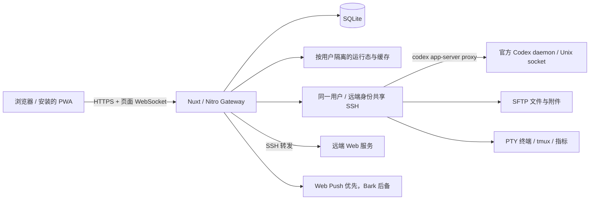

# Codex Gateway

[](nuxt.config.ts)
[](package.json)
[](package.json)
[](package.json)
[](tests/e2e)
[](docker-compose.yml)
[](LICENSE)

[English](README.md) | 中文

[功能一览](#功能一览) · [架构](#架构) · [快速开始](#快速开始) · [部署](#docker-部署) · [贡献指南](CONTRIBUTING.md)

Codex Gateway 是一个面向官方 Codex app-server 的 Web 前端与连接网关。

Gateway 通过 SSH 连接远端机器，管理官方 Codex daemon，并展示对话、审批、文件变更、思考、工具和子代理过程。每个 Gateway 账号独立管理自己的主机、置顶和通知偏好，在电脑和手机浏览器中使用同一个响应式工作区。

目标很直接：在浏览器里访问多台服务器上的 Codex 会话，同时让 Codex app-server 继续作为唯一事实源。Codex 桌面端、其他客户端和这个 Web 前端只要连接到同一个 app-server thread，就应该看到一致的状态流。

<p align="center">
  
</p>

<p align="center"><sub>在一个浏览器工作区中访问多台远端 SSH 主机上的 Codex 会话。</sub></p>

## 为什么需要

- 可以在任意浏览器使用 Codex，SSH 和远端运行时访问由 Gateway 负责。
- 可以在一个工作台里管理多台 SSH host、多个项目目录和多个 Codex thread。
- 对齐官方 Codex app-server 语义，而不是发明一套平行协议。
- 同一用户的同一台 host 在 Gateway 后端共享 SSH/RPC 生命周期，多个浏览器 tab 复用。
- 直接连接需要 keyboard-interactive MFA 的主机，无需单独部署 SSH adapter。
- 浏览器刷新、app-server 重启或 SSH 短暂断开后，后端会恢复并校准 thread 状态。
- 需要人工检查或修复远端环境时，可以在 agent loop 旁边直接打开 SSH 终端。
- 无需发布远端端口，即可在隔离的浏览器面板中预览远端 Web 应用。
- 可以跨全部主机监控 tmux 中的训练、推理等长任务，并在 pane 退出或回到 shell 时及时收到通知。
- 不离开对话工作区，就能查看 CPU、内存、网络、磁盘和 GPU 运行状态。

## 功能一览

以下界面均来自真实 Playwright E2E 环境。点击图片可查看完整尺寸。

### Codex 工作流

<table>
  <tr>
    <td width="50%">
      <a href="docs/images/features/zh/goal-progress.png"></a><br>
      <strong>Goal 生命周期</strong><br>
      <sub>同步 app-server 目标进度，并可编辑目标、暂停或恢复执行、停止和清除目标。</sub>
    </td>
    <td width="50%">
      <a href="docs/images/features/zh/plan-mode.png"></a><br>
      <strong>Plan 模式</strong><br>
      <sub>查看结构化计划，继续规划，或直接进入实施阶段。</sub>
    </td>
  </tr>
</table>

### 远端工作区

<table>
  <tr>
    <td width="50%">
      <a href="docs/images/features/zh/file-workspace.png"></a><br>
      <strong>文件、编辑与预览</strong><br>
      <sub>在 Agent 旁浏览远端文件树、编辑文本，并预览 Markdown、LaTeX、图片、PDF 和 Office 文档。</sub>
    </td>
    <td width="50%">
      <a href="docs/images/features/zh/browser-preview.png"></a><br>
      <strong>远端浏览器预览</strong><br>
      <sub>通过 SSH 打开 Host 内部 Web 服务，完整转发同源 HTTP/WebSocket 请求，并直接展示资源错误。</sub>
    </td>
  </tr>
</table>

### 运维与通知

<table>
  <tr>
    <td width="50%">
      <a href="docs/images/features/zh/host-monitoring.png"></a><br>
      <strong>主机实时指标</strong><br>
      <sub>通过 Gateway 共享实时连接持续采集 CPU、内存、网络和磁盘指标。</sub>
    </td>
    <td width="50%">
      <a href="docs/images/features/zh/gpu-process-monitoring.png"></a><br>
      <strong>GPU 进程归属</strong><br>
      <sub>查看利用率、温度、显存，以及远端训练任务的用户、PID、用时、内存和命令。</sub>
    </td>
  </tr>
  <tr>
    <td width="50%">
      <a href="docs/images/features/zh/tmux-monitoring.png"></a><br>
      <strong>跨主机 tmux 监控</strong><br>
      <sub>集中发现 pane、查看近期输出，并选择监控当前一次运行或后续每次运行。</sub>
    </td>
    <td width="50%">
      <a href="docs/images/features/zh/notifications.png"></a><br>
      <strong>浏览器与 Bark 通知</strong><br>
      <sub>接收去重后的完成通知，并直接跳转到对应对话或 tmux pane。</sub>
    </td>
  </tr>
</table>

## 架构



项目使用 Nuxt 4.6、Vue 3 和 TypeScript，浏览器状态由 Pinia 管理，工作区使用 Dockview，对话使用 TanStack Virtual，shadcn-vue / AI Elements 通过预编译工作区包复用。目前已实现的 provider 只有 Codex，协议映射集中在服务端 provider adapter。当前协议基准为 **Codex 0.163.0**，由 [codex-version.ts](server/utils/gateway/infra/codex/codex-version.ts) 定义，源码子模块对齐对应发布版本。

### 连接与账号边界

浏览器连接 Gateway，由服务端访问 SSH 和 App Server。每个页面通过一条业务 WebSocket 复用对话事件与操作、文件/Git 查询、主机状态、终端流、指标、tmux 和通知；终端输出也通过这条连接的二进制帧传输。登录、配置、列表查询、multipart 上传及文件/图片响应仍使用 HTTP；网页预览有独立的 HTTP/WebSocket 代理流量。

SSH 池在同一 Gateway 用户与远端身份下，为不同功能和浏览器页面复用连接；RPC 会话按用户、Host 和 provider 共享。Gateway 账号之间隔离 MFA 认证和订阅。配置相同远端 SSH 用户与 `CODEX_HOME` 的账号，仍会访问同一批远端文件和 Codex 对话；需要隔离这些资源时，应使用独立远端账号或 Codex 配置目录。

### 状态与历史

| 状态 | 存储位置 / 事实源 |
| --- | --- |
| 对话、Turn、时间线顺序、设置、Goal 和附件关联 | 官方远端 App Server 及其 `CODEX_HOME` |
| 用户、密码/令牌哈希、已探测的 MFA 能力、tmux 监控及历史 | Gateway SQLite |
| 主机凭据、置顶、通知偏好、Web Push 订阅和 VAPID 密钥 | Gateway SQLite 加密记录 |
| 连接、订阅、快照、事件重放、目录分组和指标采样 | 按用户隔离的 Gateway 内存，重启后重建 |
| 已加载历史和渲染状态 | 有上限的浏览器 Pinia 缓存 |
| 登录、路由、布局和文件 tab 偏好 | 浏览器本地存储 |
| 上传文件的内容 | 远端 `$CODEX_HOME/attachments/<UUID>/<原文件名>` |

目录导航从远端对话的工作目录（`cwd`）生成。置顶绑定 Host 与 thread，改动会在浏览器之间同步。Gateway SQLite 和缓存不替代 Codex 的对话存储。

冷启动通过 `thread/resume` 取得订阅和设置，包括 Plan 协作模式，通过 `thread/timeline/list` 读取历史。首次请求 **20 个时间线条目**，更多内容显式按游标分页，通常每页 100 条。展开中间过程可通过 `thread/items/read` 读取详情。热切换复用持续更新的服务端快照；事件更新快照后分发给订阅页面。重连和过期运行态校准会在需要时刷新 App Server 的权威状态。

空闲对话发送输入使用 `turn/start`，运行中的 Turn 使用 `turn/steer`，明确停止使用 `turn/interrupt`。包括 steer 在内的用户消息始终属于对话正文，中间过程折叠属于展示行为。页面重新可见或 WebSocket 重连时会刷新其他客户端修改过的对话设置。

单层虚拟列表限制挂载行数。浏览器另保留最近 10 个对话缓存，释放最近三个 Turn 以外、已完成且已折叠的中间内容，并把命令输出限制为 128 Ki 字符窗口；需要时可以重新获取旧内容。服务端历史、事件和分页缓存有上限，渲染任务随所属组件清理。这些措施减少内存保留，但不是超长活动 Turn 的固定字节上限。默认值见 [shared/config.ts](shared/config.ts)。

### Codex 安装与生命周期

Gateway 下载并校验官方 standalone 发布包，通过 SFTP 上传。支持 Linux/macOS x64/arm64，远端不需要 Node/npm。现有 npm 安装会迁移到 standalone 入口，无关 npm 包和已有 Codex 凭据继续保留。

CLI 安装与正在运行的 daemon 分别检查。Gateway 使用官方 `codex app-server daemon start` 和 `daemon update --from-cli --yes`，再通过 `codex app-server proxy` 连接。退出宽限期及符合条件的对话/Goal 恢复由 Codex 负责；恢复是尽力而为，升级可能中断任务。主机设置提供升级进度和手动重启 daemon 入口。

独立远端目标并行升级，相同 SSH 身份和凭据的别名共用升级锁。已验证发布包缓存在 Gateway 数据卷，远端使用内容寻址暂存目录，SFTP 中断后可续传；SHA-256 校验拒绝损坏文件。进度来自现有传输和生命周期流程，并同步给匹配的 Host，无需额外远端采集。

MFA 从真实 SSH keyboard-interactive 挑战中自动识别。已识别的 MFA 主机断开后需要手动点击重连；先建立连接，服务器真正请求验证码时才显示输入框。文件、终端和 RPC 随后复用同一条已认证 SSH 连接。

主机指标与 tmux 采集器使用自适应间隔、退避策略和每条 SSH 连接的后台任务并发限制。交互 RPC 和用户主动操作不经过该限制；它限制并发，不预留带宽。Linux 指标保留 300 个带时间戳的采样点，慢链路采样更慢时会覆盖更长时间。当前版本在 SSH 就绪后开始指标采集，浏览器订阅控制面板接收。

## 功能

- **服务端账号与配置**：手动创建用户，Bearer token 登录，主机、置顶对话和通知配置加密存储在 SQLite。目录分组从 Codex 对话的工作目录生成。
- **远端主机**：支持 SSH password、private key、ssh-agent、SOCKS 代理，以及自动识别的 keyboard-interactive MFA。
- **Codex runtime 管理**：standalone 安装、SFTP 断点续传升级、官方 daemon 生命周期管理、可见升级进度和手动重启。
- **会话发现与恢复**：远端目录分组、时间线游标分页、缓存切换和跨浏览器置顶同步。
- **实时 turn**：通过 WebSocket 发起新 turn、steer 运行中的 turn、中断 active turn，并响应 app-server 动态请求。
- **Plan 和 Goal 模式**：查看并执行结构化计划；设置、编辑、暂停、恢复、停止或清除 app-server goal，并在输入框和详情弹窗中查看 token/耗时进度。
- **Agent loop UI**：展示思考、命令执行、终端等待、文件编辑、流式 diff、图片、上下文压缩、sleep、MCP/tool 调用、通知和子代理侧边栏。
- **可停靠 IDE 工作区**：Agent、Files、Terminal、Browser 和 Sub-agent 面板支持分屏、缩放、浮动和弹出窗口，并按对话在本地保存布局。
- **远程文件工作区**：浏览目录与软链接、搜索文件、复制路径、编辑文本，预览 Markdown、代码、图片、PDF 和 Office 文件。文件树 Git 标记和审查视图展示变更，Diff 标题可以打开对应文件。
- **附件**：文件流经 Gateway，通过 SFTP 保存到远端 Codex 附件目录，再通过官方 `thread/attachment/*` 注册关联。解除关联不会删除仍被历史引用的文件。
- **远程终端 tab**：基于 `@xterm/xterm` 打开独立 SSH PTY 终端，和 agent loop 并排显示；终端 session 按用户和 host 隔离。
- **远程浏览器 tab**：通过 SSH 在 Dockview 中预览 Host 上的 `localhost` HTTP/HTTPS 应用，完整代理同源资源和 WebSocket，不需要额外暴露 Gateway 端口；资源失败会直接显示在预览界面中。
- **主机与 GPU 可观测性**：通过共享实时连接采集 CPU、内存、网络、磁盘、GPU 利用率、温度和显存指标；GPU 进程表会标明远端用户、PID、运行时间、内存和命令。
- **用户级 tmux 监控**：集中扫描所有已配置 Host 的 tmux session，查看最新 pane 输出，并把监控绑定到相关 Codex thread。一次性监控会在当前任务退出或回到 shell 时通知；永久监控会等待后续任务再次运行，并在每次运行结束后通知。活动监控和历史记录持久化到 SQLite。
- **多客户端同步**：多个浏览器 tab 打开同一个 thread 时，通过 Gateway 接收同一条 app-server 事件流。
- **状态修复**：SSH/app-server 重连后，Gateway 会刷新 running thread 状态；Nitro 定时任务也会扫描 stale running thread。
- **可操作通知**：主 Turn、Goal、tmux 任务完成或需要用户回答时，支持 Sonner 通知、可选 Web Push 和 Bark 后备投递。在“设置 → 通知”中授权每个浏览器；需要 HTTPS，iPhone/iPad 需先添加到主屏幕。点击通知可进入对应对话或 pane。外部投递有去重机制，推送服务接受请求不等于操作系统已显示通知。
- **移动端布局**：响应式侧边栏、输入框、长按菜单和子代理面板。
- **真实 E2E 覆盖**：Playwright 测试使用真实 Nuxt server、真实 SSH Docker target 和真实 Codex app-server。

## 项目结构

```text
.
├── app/                       # Nuxt 前端、Pinia store、chat/thread/settings UI
├── packages/gateway-ui/       # 预编译的 shadcn-vue 组件包
├── packages/gateway-ai-elements/ # 预编译的 AI Elements 组件包
├── packages/gateway-browser-runtime/ # 预编译 Markdown、高亮与文档查看器
├── server/api/                # 浏览器访问 Gateway 的 HTTP/WebSocket API
├── server/tasks/              # Nitro 定时任务入口
├── server/utils/gateway/      # SSH、Codex RPC、runtime broker、存储、通知
├── shared/                    # 前后端共享 DTO、配置、协议辅助和 thread history
├── service-worker/            # 系统推送展示和点击跳转
├── i18n/locales/              # 中文/英文 UI 文案
├── tests/e2e/                 # 真实 SSH + app-server Playwright E2E
├── third_party/openai-codex/  # 官方 Codex 源码 submodule，只用于协议参考
├── Dockerfile
└── docker-compose.yml
```

## 快速开始

前置条件：Docker Compose、Git、支持 HTTPS 的反向代理，以及 Gateway 到远端 SSH 主机和官方 Codex 发布源的网络。远端需要可用的 shell、SFTP、解压/校验工具和可写的用户目录/安装目录。模型访问和凭据需要在对应远端 Codex 账号中配置。

```bash
git clone --recurse-submodules https://github.com/yunhaoli24/codex-gateway.git
cd codex-gateway

cp .env.example .env
# 使用 openssl rand -hex 32 替换 .env 中的 CODEX_GATEWAY_CONFIG_SECRET

docker network create web-common 2>/dev/null || true
docker compose build
docker compose run --rm codex-gateway \
  node scripts/create-user.mjs admin '<至少-8-位-密码>'
docker compose up -d
```

反向代理通过 `web-common` 将公开域名转发到 `codex-gateway:3000`，并保留 WebSocket Upgrade。项目 Compose 只在该 Docker 网络暴露 `3000`，不发布宿主机端口。使用已创建的账号登录，在“设置 → 主机”添加 SSH 主机，等待安装/连接状态，再选择远端目录新建对话或打开已有 thread。SSH 请求认证后会显示 MFA 输入框。

同一个脚本可创建更多账号，每人独立配置主机。对已有用户名重新执行会重置密码并重新启用账号。系统没有单独的管理员角色，也不提供公开注册入口。

## 本地开发

```bash
corepack enable
pnpm install
export CODEX_GATEWAY_CONFIG_SECRET="development-only-secret"
export CODEX_GATEWAY_DB_PATH="$PWD/data/codex-gateway.db"
pnpm user:create <username> <password>
pnpm dev
```

使用与 Dockerfile 一致的 Node 24，以及 `package.json` 固定的 pnpm 版本。应用与维护命令使用同一个数据库路径和 secret。常用命令：

```bash
pnpm lint
pnpm build
pnpm test:e2e
```

安装阶段构建并检查三个工作区子包，再准备 Nuxt。`pnpm lint` 检查业务代码、service worker、E2E 类型、Oxlint 规则与格式，不重建或单独检查子包源码。修改子包后执行 `pnpm build:dependencies` 和 `pnpm typecheck:dependencies`。Turbo 与 Docker 依赖层复用未变化的子包产物，业务修改仍需重建 Nuxt。

环境变量：

| 变量 | 是否必需 | 说明 |
| --- | --- | --- |
| `CODEX_GATEWAY_CONFIG_SECRET` | 生产环境必需 | 用于加密保存主机、置顶对话和通知配置的稳定 secret。 |
| `CODEX_GATEWAY_DB_PATH` | 否 | SQLite 路径，默认 `/data/codex-gateway.db`；本地开发需指定可写路径。 |
| `HOST` | 否 | Nuxt 监听地址。Docker 使用 `0.0.0.0`。 |
| `PORT` | 否 | Nuxt 监听端口。Docker 使用 `3000`。 |
| `BROWSER_PREVIEW_DOMAIN` | 使用浏览器预览时 | 生成 `p-<hmac>.example.com` 等隔离 origin 的父域名；为 `*.example.com` 配置泛域名 DNS 和 TLS。 |
| `BROWSER_PREVIEW_SECRET` | 否 | 为 user/Host/target 生成稳定预览 origin 的 HMAC secret。默认复用 `CODEX_GATEWAY_CONFIG_SECRET`。 |
| `BROWSER_PREVIEW_SCHEME` | 否 | 公开预览协议，默认 `https`。仅本地 E2E/开发使用 `http`。 |
| `BROWSER_PREVIEW_PUBLIC_PORT` | 否 | 本地开发时写入预览 origin 的可选公开端口。 |

在运行中的部署创建或重置用户：

```bash
docker compose exec codex-gateway node scripts/create-user.mjs <username> <password>
```

`CODEX_GATEWAY_CONFIG_SECRET` 用于加密保存连接配置。生产环境必须设置稳定且足够长的 secret；更换 secret 会导致已有加密配置无法解密。

Compose 只传入其 `environment` 中列出的变量。使用表中其他可选运行变量时，应添加到该配置或 Compose override，仅写入 `.env` 不会自动传入容器。远端 `CODEX_HOME` 和 `CODEX_INSTALL_DIR` 则属于远端登录环境。

## 安全模型

- Gateway 在服务端执行 SSH 认证和远端访问，已登录的主机设置/配置导出属于敏感数据，可能包含凭据。
- 浏览器通过 Bearer token 登录 Gateway。
- 连接配置使用 `CODEX_GATEWAY_CONFIG_SECRET` 加密后存入 SQLite。
- Gateway 账号隔离主机配置、置顶、订阅和缓存，实际远端权限由所配置的 SSH 账号决定。
- Codex API 凭据保留在远端 Codex 环境，MFA 验证码只用于当前 SSH 挑战，不作为配置保存。
- 远程终端 tab、tmux 检查和网页预览代理都使用服务端 SSH channel，无需公开远端服务端口。
- 公网部署应该放在可信反向代理和 HTTPS 后面。

## Docker 部署

```bash
docker compose up -d --build codex-gateway
docker compose ps codex-gateway
docker compose logs --since 10m --tail 100 codex-gateway
```

默认容器只把 `3000` 暴露到 Docker 网络，适合放在 nginx、Caddy、Cloudflare Tunnel 或其他可信反向代理后面。SQLite 数据保存在 `/data/codex-gateway.db`，并通过 `./data:/data` 持久化。

默认容器内存上限为 1 GiB，V8 old-space 上限为 512 MiB。SSH/TLS 等原生缓冲区同样占用内存，不能只提高 JavaScript 堆上限代替容量评估。健康检查只探测 TCP，Nitro 独立执行定期内存维护。日志使用 Docker `json-file` 轮转，每份 `1m`，保留三份。

用户增加时，当前采用单个 Gateway 实例与持久化数据卷，重点监控内存、SSH 连接和远端负载。连接、事件分发和待处理 MFA 在进程内存中，负载均衡下的多个副本目前不是一个共享运行时。

远程浏览器面板使用 `p-<hmac>.example.com` 形式的隔离 origin。在 `.env` 设置 `BROWSER_PREVIEW_DOMAIN=example.com`，为 `*.example.com` 配置泛域名 DNS/TLS，将预览域名转发到同一个 Gateway 端口 `3000`，保留原始 Host 和 WebSocket Upgrade。Gateway 保留上游 `Content-Security-Policy` 与 `X-Frame-Options`，明确禁止 iframe 嵌入的应用仍会被浏览器阻止。

通过一致的 SQLite 备份或停容器后的数据卷快照，一起备份 `./data` 与稳定的配置 secret，妥善保护备份。远端 Codex 对话、凭据和上传附件需要单独备份。升级后内存订阅会重建，MFA 主机需要手动连接。PWA service worker 负责通知，不预缓存认证 API 响应或应用 bundle。

### 故障排查

| 现象 | 检查方向 |
| --- | --- |
| 主机无法连接 | 按 `hostId`/`hostName` 查 Gateway 日志，区分代理/TCP、SSH banner/握手、认证、SFTP 与 daemon 错误。 |
| MFA 输入框未出现 | 点击主机连接操作，等待真实 SSH 挑战；握手失败发生在可以提交验证码之前。 |
| CLI 已升级但仍无法加载对话 | 在远端登录环境执行 `codex app-server daemon version`，CLI 与运行中 daemon 有独立版本。 |
| “app server is running but is not managed” | 未托管服务占用了 socket；确认进程及启动来源，正常停止后再启动官方 daemon，不要删 socket 或结束所有 Codex 进程。 |
| 升级传输失败 | 检查用户目录、缓存/安装路径可写及 SFTP 可用性；失败暂存保留用于下次续传，校验损坏时丢弃。 |
| 网页预览失败 | 检查泛域名 DNS/TLS、Host/Upgrade 转发、远端到目标服务的连通性，以及预览中的资源诊断。 |
| 未收到推送 | 检查当前浏览器授权/订阅、账号通知设置和投递日志；优先 Web Push，Bark 需单独配置。 |

日志区分 CLI 检查、下载/缓存、SFTP 进度与 daemon 就绪。提交 issue 前请移除凭据和私密内容，信任边界见 [SECURITY.md](SECURITY.md)。

## 测试

本项目的 E2E 不 mock Codex app-server：

- Docker 构建 production Nuxt 应用，应用和浏览器分别在独立容器中运行。
- SSH 测试环境覆盖全新 standalone 安装、从 npm 迁移、daemon 升级和真实 keyboard-interactive MFA。
- Gateway 通过 SSH 连接 target，并启动或恢复真实 Codex app-server。
- Playwright 以浏览器行为验证登录、配置、thread 恢复、实时同步、移动端布局、diff 渲染、动态请求、通知、子代理 UI、远程文件、浏览器预览和真实 tmux 监控。

运行：

```bash
pnpm test:e2e
```

如果宿主机没有 `pnpm`，可以直接使用容器化测试 runner：

```bash
tests/e2e/run-in-containers.sh
```

涉及 SSH、RPC、WebSocket、thread 状态、配置、上传、diff 渲染、移动端或 app-server 协议处理的改动，都应该跑完整 E2E。

## 与 Codex 的关系

Codex Gateway 面向固定的官方 App Server 发布版本，包括项目使用的实验性时间线 API。`third_party/openai-codex/` 是协议和行为参考源码，不是部署到远端的运行时。版本门槛、协议解析器和安装测试环境一起更新，Gateway 展示 Codex 状态，将执行、审批和 daemon 恢复交给官方运行时。

## 参与贡献

欢迎提交 issue 和 pull request。修改 SSH、RPC、实时状态或 app-server 协议行为前，请先阅读 [CONTRIBUTING.md](CONTRIBUTING.md)。安全问题请按照 [SECURITY.md](SECURITY.md) 私下报告。

## License

[MIT](LICENSE)
